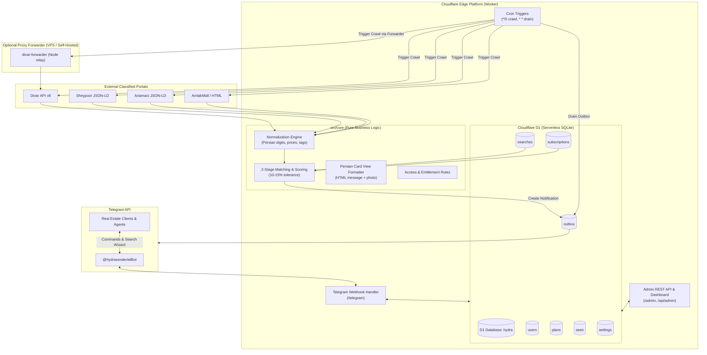
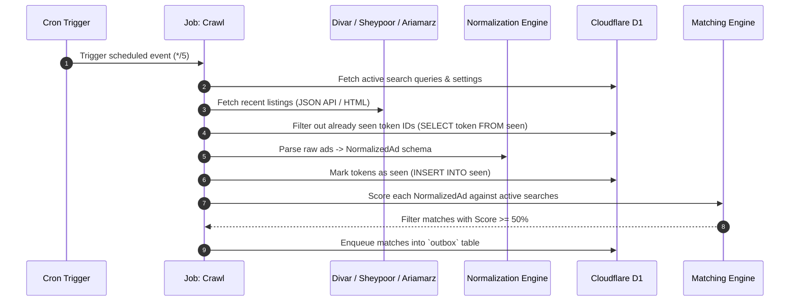
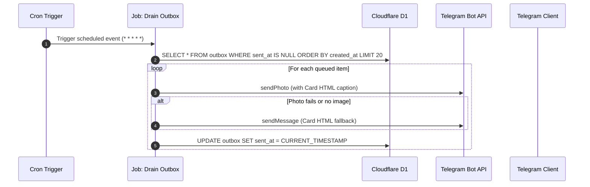
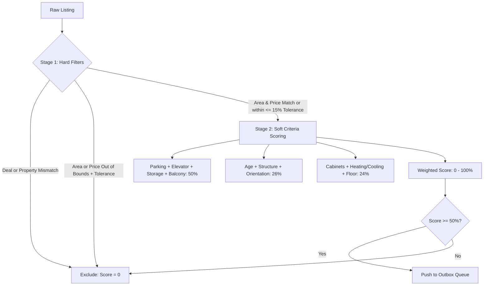
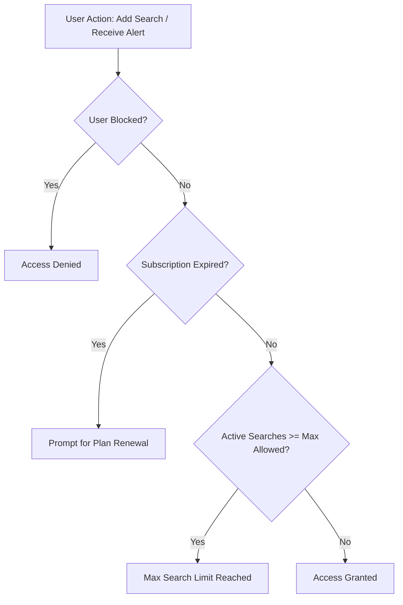
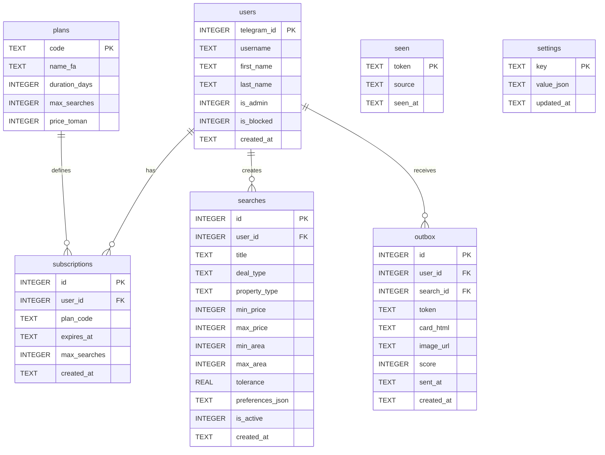

# Hydra Real Estate Platform — System Architecture

This document describes the high-level and detailed architecture of the **Hydra Real Estate Platform**, an edge-native, serverless Telegram bot and ingestion engine deployed on **Cloudflare Workers** with **Cloudflare D1 (Serverless SQLite)**.

---

## 1. Executive Summary & Goals

The platform bridges real-estate classifieds portals in Iran (Divar, Sheypoor, Ariamarz, AmlakMall) with prospective home buyers, renters, and real-estate consultants via Telegram.

### Primary Objectives:
1. **Edge-Native Zero-Server Architecture:** Operates entirely within Cloudflare Workers' free tier (100,000 requests/day, 10ms CPU time/request, D1 SQLite), removing the need for dedicated servers, VPS hosting, or manual OS maintenance.
2. **Multi-Portal Scraping & Crawling:** Ingests listings from Divar's JSON API, Sheypoor's Schema.org JSON-LD, Ariamarz's JSON-LD, and generic HTML classifieds portals.
3. **Two-Stage Matching & Tolerance Engine:** Matches user search criteria with a strict 10–15% tolerance on budget and area, followed by a weighted multi-criteria scoring algorithm on amenities and interior specifications.
4. **Interactive Persian Card View:** Delivers formatted Telegram card previews with direct portal links, price breakdowns (میلیارد / میلیون تومان), key specs, and calculated match percentages.
5. **Subscription & Access Control:** Provides a web-based administrative dashboard (`/admin/`) to manage user subscriptions, grant free/trial/paid plans, enforce search limits, and tune crawler parameters.

---

## 2. High-Level Architecture



---

## 3. Data Flow & Execution Pipelines

### 3.1. Crawl & Ingestion Pipeline (`*/5 * * * *`)
Every 5 minutes, Cloudflare Workers triggers the crawler:



### 3.2. Outbox Drain & Delivery Pipeline (`* * * * *`)
To respect Telegram rate limits and avoid timeout errors during crawling, messages are delivered via an outbox queue:



### 3.3. Telegram Bot Interaction Pipeline (Webhook `/telegram`)
1. User sends `/start` -> Bot registers user in D1, checks subscription entitlement, and grants default plan.
2. User taps **"ثبت جستجوی جدید"** (New Search) -> Bot opens multi-step wizard:
   - Step 1: Deal Type (خرید / رهن و اجاره)
   - Step 2: Property Type (آپارتمان، ویلا، کلنگی، اداری، تجاری)
   - Step 3: Area Range (e.g., `80-120` متر)
   - Step 4: Budget Range (e.g., `5-8` میلیارد تومان or `200` میلیون رهن `15` میلیون اجاره)
   - Step 5: Essential Features (پارکینگ، آسانسور، انباری، بالکن)
   - Step 6: Building & Interior Specs (سال ساخت، جهت، اسکلت، کابینت، سرمایش/گرمایش)
3. Bot saves the search record in `searches` table associated with `user_id`.

---

## 4. Subsystem Breakdown

### 4.1. Multi-Portal Ingestion Layer (`src/divar.ts`, `src/generic_html.ts`)

| Portal | Ingestion Method | Parsing Strategy | Link Format |
|---|---|---|---|
| **Divar** | REST API v8 (`/v8/postlist/w/search` + `/v8/posts-v2/web/{token}`) | Native JSON widget trees (`group_info_row`, `legend_title_row`, `chips`) | `https://divar.ir/v/{slug}/{token}` |
| **Sheypoor** | Public HTML + JSON-LD | Parses Schema.org `Offer` / `Apartment` / `Place` blobs, `amenityFeature`, `floorSize`, `numberOfRooms` | `https://www.sheypoor.com/...-{id}.html` |
| **Ariamarz** | Public HTML + JSON-LD | Parses Schema.org `SingleFamilyResidence` JSON-LD and property tables | `https://www.ariamarz.com/property/{id}` |
| **AmlakMall** | Public HTML | Extracts `<dt>/<dd>`, two-column table rows, and OpenGraph metadata | Portal direct URL |

#### Proxy Forwarder (`tools/divar-forwarder/server.mjs`)
When running outside Iran, Cloudflare edge IP addresses may occasionally encounter rate limiting or geo-blocking on Iranian services. The repository includes an optional lightweight Node.js relay (`tools/divar-forwarder`) that forwards requests only to authorized hostnames (`ALLOWED_HOSTS=api.divar.ir,www.sheypoor.com,...`) with an HMAC secret header (`DIVAR_PROXY_SECRET`).

---

### 4.2. Normalization Engine (`src/core/normalize.ts`)

Converts diverse data structures into a unified `NormalizedAd` interface:

```typescript
export interface NormalizedAd {
  token: string;
  source: string;              // 'divar', 'sheypoor', 'ariamarz', etc.
  title: string;
  url: string;
  imageUrl?: string;
  dealType: 'buy' | 'rent';
  propertyType: 'apartment' | 'house' | 'land' | 'commercial' | 'office' | 'other';
  city?: string;
  district?: string;

  // Financial values in Tomans
  totalPrice?: number;
  pricePerM2?: number;
  deposit?: number;
  rent?: number;

  // Core metrics
  area?: number;
  rooms?: number;
  floor?: number;
  totalFloors?: number;
  yearBuilt?: number;

  // Amenities
  parking?: boolean;
  elevator?: boolean;
  storage?: boolean;
  balcony?: boolean;

  // Building & interior specifications
  orientation?: 'north' | 'south' | 'east' | 'west' | 'two-sided';
  structure?: 'concrete' | 'metal' | 'other';
  cabinet?: 'mdf' | 'highglass' | 'wood' | 'metal' | 'membrane' | 'other';
  cooling?: string;
  heating?: string;

  rawLabels: Record<string, string>;
}
```

Key features:
- **Persian Numeral Translation:** Converts `۰۱۲۳۴۵۶۷۸۹` to ASCII digits.
- **Persian Text Normalizers:** Standardizes Arabic `ي` and `ك` to Persian `ی` and `ک`, removes Zero-Width Non-Joiners (ZWNJ) for comparison.
- **Currency Sanitization:** Normalizes ریال (Rials) to تومان (Tomans). Derives `pricePerM2 = totalPrice / area` when not explicitly provided by the portal.

---

### 4.3. Two-Stage Matching & Tolerance Scoring Engine (`src/core/match.ts`)

The algorithm strictly obeys real-estate domain logic:

```
Total Match Score = (HardScore × 0.55) + (SoftScore × 0.45)
```



#### Stage 1: Financial & Dimensional Hard Filters
- **Deal Type:** Exact match (`buy` or `rent`).
- **Property Type:** Exact match.
- **Tolerance Formula:** Allowed margin is user-configurable up to **15% maximum** (`MAX_TOLERANCE = 0.15`).
  $$\text{tolerance} = \min(\text{user\_tolerance}, 0.15)$$
  If a metric falls between the target range and the tolerance boundary:
  $$\text{Ratio} = \frac{|\text{actual} - \text{boundary}|}{\text{target} \times \text{tolerance}}$$
  $$\text{HardScore} = 100 - (100 \times \text{Ratio} \times 0.5)$$
  If the value exceeds the tolerance threshold, the listing is completely discarded (Score = 0).

#### Stage 2: Amenity & Interior Soft Scoring
Soft attributes are assigned specialized real-estate weights:

| Criterion | Weight | Scoring Condition |
|---|---|---|
| **Parking (پارکینگ)** | 14% | Exact match (+14%) |
| **Elevator (آسانسور)** | 14% | Exact match (+14%) |
| **Storage (انباری)** | 12% | Exact match (+12%) |
| **Balcony (بالکن)** | 10% | Exact match (+10%) |
| **Building Age (سال ساخت)** | 10% | Graded distance penalty from preferred age |
| **Structure (نوع اسکلت)** | 8% | Match on بتنی / فلزی |
| **Orientation (جهت ساختمان)** | 8% | Match on شمالی / جنوبی / دونبش |
| **Cabinets (نوع کابینت)** | 8% | Match on ام‌دی‌اف / های‌گلاس / چوب / ممبران |
| **Cooling & Heating (سرمایش/گرمایش)** | 8% | Match on اسپلیت / پکیج / چیلر / شوفاژ |
| **Floor & Rooms (طبقه و خواب)** | 8% | Preferred floor level and bedroom count |

Missing data in an ad never penalizes the listing; only explicit discrepancies reduce soft score points.

---

### 4.4. Telegram Card View Presentation (`src/core/card.ts`)

Every match card is rendered using Telegram HTML formatting with Persian typography and natural numeral groupings:

```html
🏡 <b>آپارتمان ۱۱۰ متری دو خوابه فول امکانات</b>
🎯 تطابق با نیاز شما: <b>۸۸٪</b>
📍 تهران، سعادت‌آباد

💰 <b>قیمت کل:</b> ۷ میلیارد و ۵۰۰ میلیون تومان
🏷 <b>قیمت هر متر:</b> ۶۸.۱ میلیون تومان

📐 <b>مشخصات:</b>
• متراژ: ۱۱۰ متر | خواب: ۲ | طبقه: ۳ از ۵
• سال ساخت: ۱۳۹۸ | جهت: جنوبی | اسکلت: بتنی

✨ <b>امکانات:</b>
 پارکینگ: دارد |  آسانسور: دارد |  انباری: دارد |  بالکن: دارد
• کابینت: های‌گلاس | سرمایش: اسپلیت | گرمایش: پکیج

🔗 <a href="https://divar.ir/v/...">مشاهده آگهی در دیوار</a>
```

---

### 4.5. Subscription & Access Management (`src/core/access.ts`, `src/admin.ts`)

The platform implements multi-tier subscription and quota control:



#### Subscription Plans (`plans` table):
- **Free / آزمایشی:** 1 active search query, 7-day duration, capped match alerts.
- **Standard / برنزی:** 3 active searches, 30 days.
- **Pro / طلایی (مشاورین املاک):** 10 active searches, 90 days, priority notifications.
- **Unlimited / ادمین:** Unlimited searches and lifetime access.

#### Admin Web Dashboard (`/admin/`):
Served directly by Cloudflare Workers at the edge as a single-page HTML/JS application:
- User list with manual subscription grant/revoke, expiry extension, and blocking.
- Live inspection tool to test Divar/Sheypoor scraping and label extraction on live URLs.
- Telegram webhook verification & registration button.
- Global crawler settings editor (cities, tolerance defaults, crawl budgets).

---

## 5. Database Schema (Cloudflare D1 SQLite)



---

## 6. Cloudflare Free-Tier Resource Budgets

Cloudflare Workers Free Plan imposes specific constraints:
- **CPU Time:** 10 ms per subrequest / invocation.
- **Subrequests:** 50 simultaneous external fetch calls per invocation.
- **D1 Database:** 5,000,000 read units / month, 100,000 write units / day.

### Optimization Strategies Applied:
1. **Budgeted Batching:** `crawl_budget` defaults to 40 (leaves 10 safety margins from the 50 subrequest limit).
2. **D1 Read/Write Minimization:** `seen` table lookups use indexed primary keys with bulk `SELECT ... WHERE token IN (...)`.
3. **Decoupled Outbox Queue:** Crawling and delivery run on separate cron triggers (`*/5` for crawling, `* *` for delivery) so Telegram message latency never exhausts crawler CPU time.
4. **Pure-Core Isolation:** `src/core/` contains 0 Cloudflare imports, ensuring ultra-fast cold starts and 100% portable unit tests using Node's native test runner (`node --test`).
