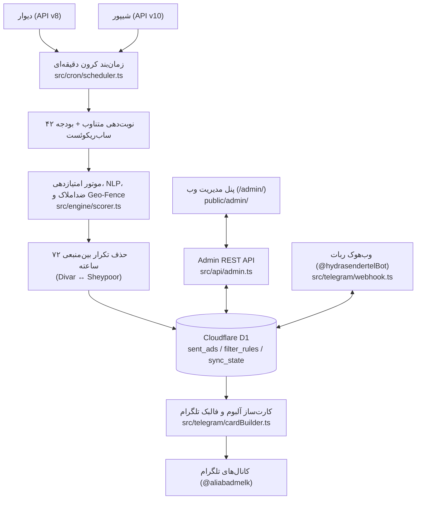

<div dir="rtl">

# ربات هوشمند پایش آگهی‌های املاک هیدرا (Hydra Real Estate Bot) 🏠🤖

[](https://hydra-bot.a77aslani.workers.dev/admin/)
[](migrations/0001_init.sql)
[](tests)
[](https://hydra.startstar.ir/)
[](https://www.linkedin.com/in/aliaslanik)

🌐 **[وب‌سایت رسمی و دمو زنده](https://hydra.startstar.ir/)** · 📘 **[صفحه SEO و مستندات فنی](https://hydra.startstar.ir/seo.html)** · 🖥 **[پنل مدیریت وب (Dashboard)](https://hydra-bot.a77aslani.workers.dev/admin/)** · 🤖 **[@hydrasendertelBot](https://t.me/hydrasendertelBot)** · 📢 **[@aliabadmelk](https://t.me/aliabadmelk)** · 🌍 **[English README](README.en.md)**

> 📌 **جداسازی پروژه از نسخه قدیمی هیدرا سندر:**  
> نسخه قدیمی اسکریپت پایتون ارسال چهارپیام‌رسانی (تلگرام، بله، روبیکا، ایتا) برای نگهداری تاریخچه در شاخه و تگ [`legacy-hydra-sender`](https://github.com/aliaslany/hydra-sender/tree/legacy-hydra-sender) بایگانی شده است و شاخه اصلی (`HydraSender`) به‌طور کامل به **ربات هوشمند پایش و ارسال آگهی‌های املاک روی کلودفلر ورکرز** اختصاص دارد.

---

## ✨ قابلیت‌های کلیدی

* **پایش دو منبعی دیوار و شیپور (`Divar API v8` + `Sheypoor API v10`):**
  * پشتیبانی از جستجوی چندشهری (`resolveSheypoorCitySlugs`) و جداسازی صفحه‌بندی هر منبع در فاز `BACKFILL` و `LIVE`.
  * نوبت‌دهی متناوب و عادلانه (`interleaveSourceTokens`) برای جلوگیری از گرسنگی شیپور زیر سقف ساب‌ریکوئست کلودفلر (`42` ساب‌ریکوئست در هر کرون‌تیک).
  * فیلتر کردن بلاک‌های تبلیغاتی بین‌شهری شیپور (پذیرش صرفاً `block.type === 'normal'`).
* **موتور امتیازدهی دو مرحله‌ای و تشخیص معامله/کاربری ([`src/engine/scorer.ts`](src/engine/scorer.ts)):**
  * تشخیص نوع معامله واقعی (`BUY` در برابر `RENT`) از ساختار دسته‌بندی و قیمت‌ها (`inferDealType`) و جلوگیری از ورود آگهی‌های اجاره یا تجاری در فیلترهای فروش مسکونی.
  * تلورانس پویا تا **±۲۵٪** (پیش‌فرض ±۱۵٪) روی بودجه، متراژ و تبدیل استاندارد رهن و اجاره (`۳٪`).
  * پردازش زبان طبیعی فارسی (NLP) با نرمال‌سازی حروف/اعداد، مرزهای یونیکد فارسی، درک عبارات نفی («بدون پارکینگ»، «انباری ندارد») و استخراج سن بنا، واحد در طبقه، سند، نما، جهت، اسکلت، کابینت، سرمایش و گرمایش.
* **فیلترهای امنیتی و جغرافیایی پیشرفته:**
  * حذف آگهی‌های مشاورین و دپارتمان‌های املاک (`businessType` + اسکن کلمات منفی).
  * کنترل دقیق شهر، محله (`districts_json`) و محدوده چندضلعی نقشه (`Geo-Fence`) روی نقشه تعاملی Leaflet در داشبورد.
  * اثر انگشت ساختاری دقیق (`computeAdFingerprint`) و حذف تکرار فقط بین دو منبع (`Divar <-> Sheypoor`) در پنجره ۷۲ ساعته.
* **تحویل هوشمند تلگرام و پایداری عملیاتی:**
  * ارسال آلبوم چندتصویری (`sendMediaGroup`) با زنجیره بازیابی خودکار (`sendPhoto` ← `sendMessage`) هنگام خطای مدیای CDN.
  * برندینگ اختصاصی به ازای هر کانال (شماره موبایل، تلفن ثابت، آدرس دفتر و هشتگ‌ها).
  * عقب‌نشینی نمایی (`next_retry_at`) برای خطاهای کامل و جزئی، توقف خودکار در خطاهای پیاپی و پاک‌سازی ساعتی لاگ‌ها.
* **پنل مدیریت وب استاتیک ([`public/admin/`](public/admin/index.html)):**
  * ارائه‌شده مستقیم از لبه کلودفلر با `[assets]`، تم تاریک/روشن با فونت وزیرمتن، نقشه رسم محدوده Polygon، فیلترهای مرحله دوم کامل، فید بی‌نهایت وضعیت ارسال، تب لاگ‌ها و شبیه‌ساز زنده امتیازدهی.

---

## 🏛 معماری سامانه



---

## 🗂 ساختار مخزن

```text
├── index.html              # وب‌سایت معرفی تعاملی و دمو زنده (GitHub Pages: hydra.startstar.ir)
├── seo.html                # صفحه تخصصی SEO و راهنمای معماری سامانه
├── sitemap.xml / robots.txt
├── assets/                 # استایل، اسکریپت شبیه‌ساز زنده و کاور برداری وب‌سایت
├── migrations/
│   ├── 0001_init.sql       # اسکیمای پایه جدول‌های D1
│   └── 0002_improvements.sql
├── public/admin/           # پنل مدیریت وب استاتیک (سرو مستقیم در /admin/)
├── src/
│   ├── index.ts            # مسیریابی Worker و بوت‌استرپ امن D1
│   ├── types.ts            # تایپ‌های تایپ‌اسکریپت
│   ├── api/admin.ts        # اندپوینت‌های مدیریت قوانین، کانال‌ها، اشتراک و شبیه‌ساز
│   ├── cron/scheduler.ts   # کرون، صف ارسال، بودجه‌بندی، Backoff و پاک‌سازی
│   ├── divar/scraper.ts    # کلاینت دیوار API v8
│   ├── sheypoor/scraper.ts # کلاینت شیپور API v10
│   ├── engine/             # امتیازدهی، NLP، ضداملاک و Geo-Fence
│   └── telegram/           # کارت‌ساز آلبوم/متن و ویزارد وب‌هوک
├── tests/                  # ۲۶ تست واحد Vitest (scorer, geo, cardBuilder, sheypoor, scheduler)
└── .github/workflows/deploy.yml
```

---

## 🚀 راه‌اندازی، تست و استقرار

```bash
# ۱. نصب وابستگی‌ها
npm install

# ۲. بررسی تایپ‌ها و اجرای ۲۶ تست خودکار
npm run typecheck
npm test

# ۳. اعمال اسکیمای پایه در دیتابیس Cloudflare D1
npx wrangler d1 execute hydra-db --remote --file=migrations/0001_init.sql

# ۴. تنظیم متغیرهای محرمانه و استقرار روی Cloudflare Workers
npx wrangler secret put BOT_TOKEN
npx wrangler secret put TELEGRAM_WEBHOOK_SECRET
npx wrangler secret put ADMIN_MASTER_TOKEN
npx wrangler deploy
```

> 💡 برای استقرار خودکار در GitHub Actions، دو مقدار `CLOUDFLARE_API_TOKEN` و `CLOUDFLARE_ACCOUNT_ID` را در بخش **Settings → Secrets and variables → Actions** مخزن ثبت کنید.

---

## 👨‍💻 توسعه‌دهنده و ارتباط مستقیم

* **علی اصلانی (Ali Aslani)**
* 💼 **لینکدین:** [linkedin.com/in/aliaslanik](https://www.linkedin.com/in/aliaslanik)
* 💻 **گیت‌هاب:** [github.com/aliaslany/hydra-sender](https://github.com/aliaslany/hydra-sender)
* 🌐 **وب‌سایت و دمو:** [hydra.startstar.ir](https://hydra.startstar.ir/)
* 🖥 **پنل مدیریت:** [hydra-bot.a77aslani.workers.dev/admin/](https://hydra-bot.a77aslani.workers.dev/admin/)

</div>
