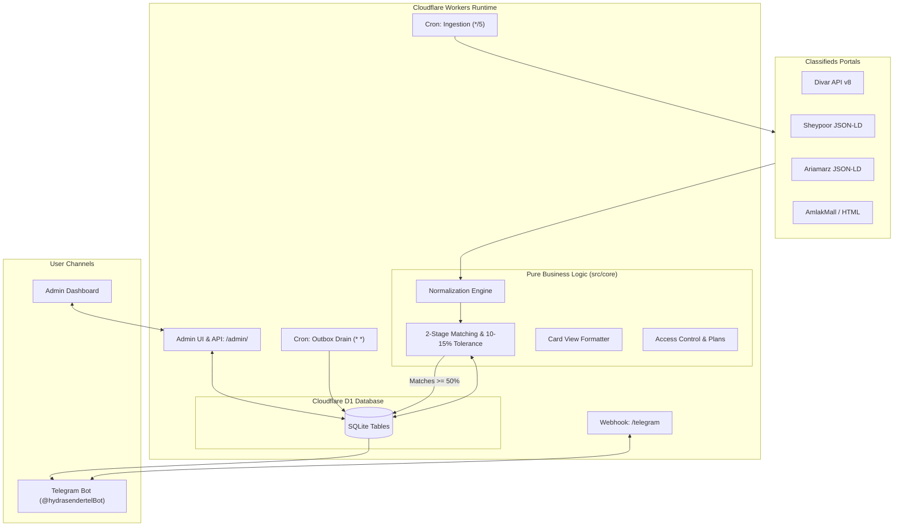

# Hydra Real Estate & Classifieds Multi-Messenger Platform 🏢🤖

[](https://workers.cloudflare.com/)
[](https://developers.cloudflare.com/d1/)
[](https://core.telegram.org/bots/api)
[](worker/test)

A high-performance, edge-native Telegram platform and multi-messenger broadcaster for Iranian real estate classifieds (**Divar**, **Sheypoor**, **Ariamarz**, and **AmlakMall**).

---

## 📑 Table of Contents

- [Overview & Systems](#overview--systems)
- [System Architecture](#system-architecture)
- [Features & Capabilities](#features--capabilities)
- [Requirements & Compliance Checklist](#requirements--compliance-checklist)
- [Quick Start: Cloudflare Real Estate Bot (`worker/`)](#quick-start-cloudflare-real-estate-bot-worker)
- [Admin Dashboard (`/admin/`)](#admin-dashboard-admin)
- [Telegram Bot User Guide](#telegram-bot-user-guide)
- [Testing & Quality Assurance](#testing--quality-assurance)
- [Legacy Channel Broadcaster (GitHub Actions)](#legacy-channel-broadcaster-github-actions)
- [Documentation Index](#documentation-index)

---

## 🌟 Overview & Systems

This repository contains two independent, production-ready systems:

1. **[NEW] Cloudflare Real Estate Agent Platform (`worker/`)**:
   - **Edge Serverless Architecture**: Deployed on Cloudflare Workers and Cloudflare D1 (Serverless SQLite) — zero servers, 100% free tier compatible.
   - **Multi-Portal Scraping**: Ingests real estate listings from **Divar** (API v8), **Sheypoor** (Schema.org JSON-LD), **Ariamarz** (Schema.org JSON-LD), and generic HTML sources.
   - **Two-Stage Matching & Scoring Engine**: Capped 10–15% tolerance on budget and area, followed by multi-criteria weighted scoring on amenities and building specs.
   - **Persian Card Views**: Delivers rich listing summaries with match badges (`🎯 ۸۸٪ تطابق`), price breakdowns (میلیارد / میلیون تومان), and direct portal links.
   - **Subscription & Access Control**: Full quota and plan enforcement (Free/Trial/Paid) with a web-based Admin Dashboard (`/admin/`).

2. **Legacy Channel Broadcaster (`root`)**:
   - Runs on GitHub Actions cron schedules to broadcast new Divar ads into Telegram channels, Bale, Rubika, and Eitaa.

---

## 🏛 System Architecture

The new real estate platform is built around serverless edge computing and event-driven pipelines:



For the comprehensive design document with sequence diagrams, subrequest budgeting, and class structures, see **[`ARCHITECTURE.md`](ARCHITECTURE.md)**.

---

## ✨ Features & Capabilities

### 1. Multi-Portal Crawling
- **Divar**: Direct reverse-engineered client for `/v8/postlist/w/search` and `/v8/posts-v2/web/{token}` with full widget parsing.
- **Sheypoor**: Extracts structured Schema.org `Offer` / `Apartment` / `Place` JSON-LD (`floorSize`, `numberOfRooms`, `amenityFeature` [Parking, Storage, Elevator], `additionalProperty` [Year, Price per m²]).
- **Ariamarz**: Ingests Schema.org `SingleFamilyResidence` JSON-LD schemas.
- **Generic HTML Crawler**: Extracted via `<dt>/<dd>`, two-span key-value pairs, table rows, and OpenGraph tags for sites like AmlakMall.

### 2. Two-Stage Matching & Tolerance Engine
- **Stage 1 (Hard Filters & Financials)**:
  - Deal Type (`خرید و فروش` / `رهن و اجاره`)
  - Property Type (`آپارتمان`, `ویلایی`, `کلنگی`, `تجاری`, `اداری`)
  - Budget (Total price, price per m², deposit, rent)
  - Area bounds (Minimum and maximum square meters)
  - **10–15% Tolerance**: Metric values within the 10–15% margin receive quadratic score penalties; values beyond tolerance are discarded immediately.
- **Stage 2 (Soft Criteria & Scoring)**:
  - Key amenities: Parking (14%), Elevator (14%), Storage (12%), Balcony (10%).
  - Building specifications: Age (10%), Structure (8%), Orientation (8%).
  - Interior specifications: Cabinets (8%), Cooling/Heating (8%), Floor & Rooms (8%).
  - Produces an exact percentage match (`0% – 100%`). Listings with score $\ge 50\%$ are notified.

### 3. Persian Card View Output
- Clean Telegram formatting with Persian typography and numerals.
- Natural Persian currency units (e.g. `۷ میلیارد و ۵۰۰ میلیون تومان`).
- Key specs inline summary (`متراژ: ۱۱۰ متر | خواب: ۲ | طبقه: ۳ از ۵`).
- Direct portal deep links for instant viewing.

### 4. Subscription & Access Management
- **Plans**: Free / Trial (7 days, 1 search), Standard (30 days, 3 searches), Pro / Real Estate Agents (90 days, 10 searches), and Admin (unlimited).
- **Web Admin Dashboard (`/admin/`)**:
  - Grant or revoke user plans and search quotas.
  - Block/unblock users.
  - Live scraper testing utility (inspect raw Divar/Sheypoor URLs and extracted tags).
  - Webhook registration and health status checks.

---

## 📋 Requirements & Compliance Checklist

All features requested for the Real Estate Telegram Bot have been implemented and verified. See **[`REQUIREMENTS.md`](REQUIREMENTS.md)** for the full requirement-by-requirement compliance matrix.

---

## 🚀 Quick Start: Cloudflare Real Estate Bot (`worker/`)

### Prerequisites
- Node.js $\ge 20$ (Node 22 recommended)
- A Cloudflare account (Free Plan is sufficient)
- A Telegram bot token from [@BotFather](https://t.me/BotFather)

### Deployment Steps

1. **Clone the repository and enter `worker/`:**
   ```bash
   git clone https://github.com/aliaslany/hydra-sender.git
   cd hydra-sender/worker
   npm install --legacy-peer-deps
   ```

2. **Configure your Cloudflare credentials:**
   ```bash
   export CLOUDFLARE_API_TOKEN="your-api-token"
   export CLOUDFLARE_ACCOUNT_ID="your-account-id"
   ```

3. **Configure D1 Database:**
   Create a D1 database named `hydra` in your Cloudflare dashboard and copy its ID into `wrangler.jsonc`:
   ```jsonc
   "d1_databases": [
     {
       "binding": "DB",
       "database_name": "hydra",
       "database_id": "YOUR_D1_DATABASE_ID"
     }
   ]
   ```
   *(Note: The database tables automatically bootstrap upon the first request via `ensureSchema`)*

4. **Set production secrets:**
   ```bash
   npx wrangler secret put BOT_TOKEN           # Telegram bot token
   npx wrangler secret put WEBHOOK_SECRET      # Random secret string for webhook validation
   npx wrangler secret put ADMIN_TOKEN         # Password for accessing /admin/
   ```

5. **Deploy to Cloudflare:**
   ```bash
   npm run deploy
   ```

6. **Register Telegram Webhook:**
   Open `https://<your-worker>.workers.dev/admin/`, log in using your `ADMIN_TOKEN`, navigate to **اتصال‌ها** and click **ثبت وب‌هوک تلگرام**.

---

## 🖥 Admin Dashboard (`/admin/`)

The Cloudflare Worker hosts a built-in administrative single-page dashboard at `/admin/`:

- **کاربران و اشتراک‌ها (Users & Subscriptions):** View all bot users, edit plan limits, grant trial/pro access, or block abusive accounts.
- **تست و بررسی اتصال (Crawler Inspector):** Paste any Divar or Sheypoor URL to verify connectivity and see parsed labels in real-time.
- **تنظیمات موتور (Engine Settings):** Modify default search cities, categories, tolerance ceilings, and subrequest crawl budgets without redeploying code.

---

## 💬 Telegram Bot User Guide

1. Start a conversation with the bot: **`/start`**
2. The bot registers your profile and assigns the default trial subscription.
3. Click **" ثبت جستجوی جدید"** to start the interactive filter wizard:
   - Choose deal type (خرید / رهن و اجاره).
   - Select property category (آپارتمان، ویلایی، اداری، تجاری).
   - Input budget and area range.
   - Choose required amenities (پارکینگ، آسانسور، انباری، بالکن).
   - Specify preferences for building age, structure type, and interior finish.
4. As new listings appear on Divar, Sheypoor, or Ariamarz, the bot evaluates them against your criteria and delivers immediate Card Views for matching properties.

---

## 🧪 Testing & Quality Assurance

The project contains 24 automated test suites covering normalization, parsing, matching tolerance, outbox delivery, subscription quotas, and real JSON-LD payloads.

Run all tests locally:
```bash
cd worker
npm test
```

Test output:
```text
✔ admin API requires the token
✔ plans, grant, block, user search
✔ settings are validated and persisted
✔ crawl -> match -> drain delivers once, only to matching and entitled users
✔ wizard: /start grants default plan, steps through to a saved search
✔ inside range scores 100
✔ inside tolerance gets partial credit, beyond tolerance is excluded
✔ tolerance is capped at 15%
✔ unknown ad values are not counted against the ad
✔ soft criteria lower the score but never exclude
✔ parseNum handles Persian digits, separators and words
✔ normalizeAd maps labels, flags and derives price per m2
✔ card formatting
✔ siteAd extracts real Sheypoor Schema.org Offer/Apartment JSON-LD correctly
✔ siteAd extracts Ariamarz SingleFamilyResidence JSON-LD correctly
ℹ tests 24 | pass 24 | fail 0
```

---

## 📡 Legacy Channel Broadcaster (GitHub Actions)

The repository retains full backward compatibility for the legacy GitHub Actions multi-messenger broadcaster in the root directory (`main.py`).

- **Broadcasting Destinations**: Telegram channels, Bale, Rubika, and Eitaa.
- **Workflow**: Runs on `.github/workflows/run-bot.yml`.
- **Environment variables required**: `SEARCH_CITY_IDS`, `SEARCH_CATEGORY`, `BOT_TOKEN`, `BOT_CHATID`.
- **State storage**: Persisted in `tokens.json`.

---

## 📚 Documentation Index

- **[`ARCHITECTURE.md`](ARCHITECTURE.md)**: System design, sequence diagrams, tolerance math, D1 ERD, and Cloudflare subrequest budgeting.
- **[`REQUIREMENTS.md`](REQUIREMENTS.md)**: Full compliance checklist for all real estate agent requirements.
- **[`worker/README.md`](worker/README.md)**: Detailed Cloudflare Worker setup, reverse proxy forwarder guide, and crawler configuration.

---

## 📄 License

MIT / Original Upstream License.
